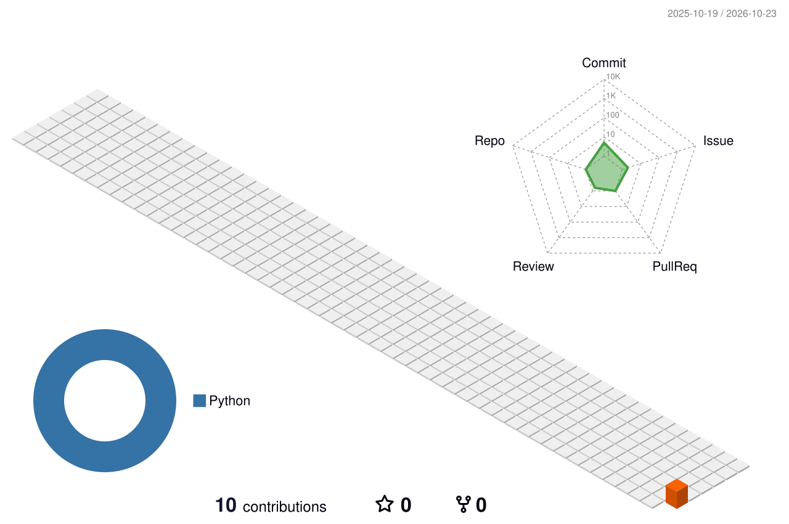

<picture></picture>

<p align="center">
  <a href="https://github.com/piggivn"></a>
  <picture></picture>
</p>

<p align="center">
  <picture></picture>
</p>

---

### 🚀 About me

- 🛠️ Day to day: **Go microservices**, **GraphQL APIs**, **MySQL tuning**, event-driven workers with **RabbitMQ**
- 🕵️ On the side: **reverse engineering** apps and automating boring stuff with **n8n**
- 🌱 Currently learning: system design, performance profiling, advanced TypeScript
- 💡 Motto: *Clean over clever · Explicit over implicit · Ship it, then refactor*

### 🧑‍💻 My code style in a nutshell

```ts
const bao = {
  philosophy: ['clean > clever', 'explicit > implicit', 'simple > complex', 'practical > perfect'],
  style: { indent: 2, quotes: 'single', semicolons: true, trailingCommas: true, maxLineLength: 120 },
  async: 'always await, never .then()',
  controlFlow: 'early returns > nested ifs',
  errors: 'log with context, re-throw, never swallow',
  commits: ['feat:', 'fix:', 'refactor:', 'docs:', 'chore:'],
  avoid: ['magic numbers', 'long parameter lists', 'over-engineering'],
};
```

### 🧰 Tech stack

<p align="center">
  <picture></picture>
</p>

### 💬 Ask me about

`Go concurrency` · `GraphQL schema design` · `MySQL query tuning` · `RabbitMQ consumers & workers` · `Reverse engineering mobile apps` · `n8n automation` · `Race conditions in payment flows`

### 🎯 2026 roadmap

- [ ] Handle race conditions in concurrent systems like a pro
- [ ] Master advanced TypeScript patterns
- [ ] Get fluent at performance profiling & optimization
- [ ] Level up system design and API design
- [ ] Push test coverage on the edge cases that actually bite

<details>
<summary><b>📊 GitHub stats</b></summary>
<br />
<p align="center">
  <picture></picture>
  <picture></picture>
</p>
</details>

### 🏙️ Contributions in 3D

<picture>
  <source media="(prefers-color-scheme: dark)" srcset="profile-3d-contrib/profile-night-rainbow.svg" />
  
</picture>

### 📝 Recent activity

<!--START_SECTION:activity-->
1. 🔒 Closed issue [#3](https://github.com/baotpt-crypto/baotpt-crypto/issues/3) in [baotpt-crypto/baotpt-crypto](https://github.com/baotpt-crypto/baotpt-crypto)
2. 💪 Opened PR [#2](https://github.com/baotpt-crypto/baotpt-crypto/pull/2) in [baotpt-crypto/baotpt-crypto](https://github.com/baotpt-crypto/baotpt-crypto)
<!--END_SECTION:activity-->

### ♟️ Play chess with me

<!-- CHESS:START -->
<p align="center">
  <picture></picture>
</p>

**Game #1** · move 1 · it's **⚫ Black**'s turn. Anyone can play: click a move below and submit the issue.

<details><summary><b>🎯 Pick your move</b></summary>

| Piece | Move to |
|:-:|:--|
| ♟ **a7** | [a5](https://github.com/baotpt-crypto/baotpt-crypto/issues/new?title=chess%7Cmove%7Ca7a5&body=Just%20press%20%2A%2ASubmit%20new%20issue%2A%2A%2C%20a%20bot%20will%20play%20your%20move%20%E2%99%9F%EF%B8%8F) [a6](https://github.com/baotpt-crypto/baotpt-crypto/issues/new?title=chess%7Cmove%7Ca7a6&body=Just%20press%20%2A%2ASubmit%20new%20issue%2A%2A%2C%20a%20bot%20will%20play%20your%20move%20%E2%99%9F%EF%B8%8F) |
| ♟ **b7** | [b5](https://github.com/baotpt-crypto/baotpt-crypto/issues/new?title=chess%7Cmove%7Cb7b5&body=Just%20press%20%2A%2ASubmit%20new%20issue%2A%2A%2C%20a%20bot%20will%20play%20your%20move%20%E2%99%9F%EF%B8%8F) [b6](https://github.com/baotpt-crypto/baotpt-crypto/issues/new?title=chess%7Cmove%7Cb7b6&body=Just%20press%20%2A%2ASubmit%20new%20issue%2A%2A%2C%20a%20bot%20will%20play%20your%20move%20%E2%99%9F%EF%B8%8F) |
| ♟ **c7** | [c5](https://github.com/baotpt-crypto/baotpt-crypto/issues/new?title=chess%7Cmove%7Cc7c5&body=Just%20press%20%2A%2ASubmit%20new%20issue%2A%2A%2C%20a%20bot%20will%20play%20your%20move%20%E2%99%9F%EF%B8%8F) [c6](https://github.com/baotpt-crypto/baotpt-crypto/issues/new?title=chess%7Cmove%7Cc7c6&body=Just%20press%20%2A%2ASubmit%20new%20issue%2A%2A%2C%20a%20bot%20will%20play%20your%20move%20%E2%99%9F%EF%B8%8F) |
| ♟ **d7** | [d5](https://github.com/baotpt-crypto/baotpt-crypto/issues/new?title=chess%7Cmove%7Cd7d5&body=Just%20press%20%2A%2ASubmit%20new%20issue%2A%2A%2C%20a%20bot%20will%20play%20your%20move%20%E2%99%9F%EF%B8%8F) [d6](https://github.com/baotpt-crypto/baotpt-crypto/issues/new?title=chess%7Cmove%7Cd7d6&body=Just%20press%20%2A%2ASubmit%20new%20issue%2A%2A%2C%20a%20bot%20will%20play%20your%20move%20%E2%99%9F%EF%B8%8F) |
| ♟ **e7** | [e5](https://github.com/baotpt-crypto/baotpt-crypto/issues/new?title=chess%7Cmove%7Ce7e5&body=Just%20press%20%2A%2ASubmit%20new%20issue%2A%2A%2C%20a%20bot%20will%20play%20your%20move%20%E2%99%9F%EF%B8%8F) [e6](https://github.com/baotpt-crypto/baotpt-crypto/issues/new?title=chess%7Cmove%7Ce7e6&body=Just%20press%20%2A%2ASubmit%20new%20issue%2A%2A%2C%20a%20bot%20will%20play%20your%20move%20%E2%99%9F%EF%B8%8F) |
| ♟ **f7** | [f5](https://github.com/baotpt-crypto/baotpt-crypto/issues/new?title=chess%7Cmove%7Cf7f5&body=Just%20press%20%2A%2ASubmit%20new%20issue%2A%2A%2C%20a%20bot%20will%20play%20your%20move%20%E2%99%9F%EF%B8%8F) [f6](https://github.com/baotpt-crypto/baotpt-crypto/issues/new?title=chess%7Cmove%7Cf7f6&body=Just%20press%20%2A%2ASubmit%20new%20issue%2A%2A%2C%20a%20bot%20will%20play%20your%20move%20%E2%99%9F%EF%B8%8F) |
| ♟ **g7** | [g5](https://github.com/baotpt-crypto/baotpt-crypto/issues/new?title=chess%7Cmove%7Cg7g5&body=Just%20press%20%2A%2ASubmit%20new%20issue%2A%2A%2C%20a%20bot%20will%20play%20your%20move%20%E2%99%9F%EF%B8%8F) [g6](https://github.com/baotpt-crypto/baotpt-crypto/issues/new?title=chess%7Cmove%7Cg7g6&body=Just%20press%20%2A%2ASubmit%20new%20issue%2A%2A%2C%20a%20bot%20will%20play%20your%20move%20%E2%99%9F%EF%B8%8F) |
| ♟ **h7** | [h5](https://github.com/baotpt-crypto/baotpt-crypto/issues/new?title=chess%7Cmove%7Ch7h5&body=Just%20press%20%2A%2ASubmit%20new%20issue%2A%2A%2C%20a%20bot%20will%20play%20your%20move%20%E2%99%9F%EF%B8%8F) [h6](https://github.com/baotpt-crypto/baotpt-crypto/issues/new?title=chess%7Cmove%7Ch7h6&body=Just%20press%20%2A%2ASubmit%20new%20issue%2A%2A%2C%20a%20bot%20will%20play%20your%20move%20%E2%99%9F%EF%B8%8F) |
| ♞ **b8** | [a6](https://github.com/baotpt-crypto/baotpt-crypto/issues/new?title=chess%7Cmove%7Cb8a6&body=Just%20press%20%2A%2ASubmit%20new%20issue%2A%2A%2C%20a%20bot%20will%20play%20your%20move%20%E2%99%9F%EF%B8%8F) [c6](https://github.com/baotpt-crypto/baotpt-crypto/issues/new?title=chess%7Cmove%7Cb8c6&body=Just%20press%20%2A%2ASubmit%20new%20issue%2A%2A%2C%20a%20bot%20will%20play%20your%20move%20%E2%99%9F%EF%B8%8F) |
| ♞ **g8** | [f6](https://github.com/baotpt-crypto/baotpt-crypto/issues/new?title=chess%7Cmove%7Cg8f6&body=Just%20press%20%2A%2ASubmit%20new%20issue%2A%2A%2C%20a%20bot%20will%20play%20your%20move%20%E2%99%9F%EF%B8%8F) [h6](https://github.com/baotpt-crypto/baotpt-crypto/issues/new?title=chess%7Cmove%7Cg8h6&body=Just%20press%20%2A%2ASubmit%20new%20issue%2A%2A%2C%20a%20bot%20will%20play%20your%20move%20%E2%99%9F%EF%B8%8F) |

</details>

| Recent move | Played by |
|:-:|:--|
| `e4` | [@baotpt-crypto](https://github.com/baotpt-crypto) |

<!-- CHESS:END -->

### 🎮 Arcade corner

<picture>
  <source media="(prefers-color-scheme: dark)" srcset="https://raw.githubusercontent.com/baotpt-crypto/baotpt-crypto/output/pacman-contribution-graph-dark.svg" />
  
</picture>

<details>
<summary><b>🕹️ More games on my contribution grid</b></summary>

#### 🐍 Snake

<picture>
  <source media="(prefers-color-scheme: dark)" srcset="https://raw.githubusercontent.com/baotpt-crypto/baotpt-crypto/output/github-snake-dark.svg" />
  
</picture>

#### 🚀 Galaga

<picture></picture>

#### 🧱 Breakout

<picture>
  <source media="(prefers-color-scheme: dark)" srcset="https://raw.githubusercontent.com/baotpt-crypto/baotpt-crypto/output/breakout-contribution-graph-dark.svg" />
  
</picture>

</details>

### 😂 Dev joke of the visit

<p align="center">
  <picture></picture>
</p>

<picture></picture>
